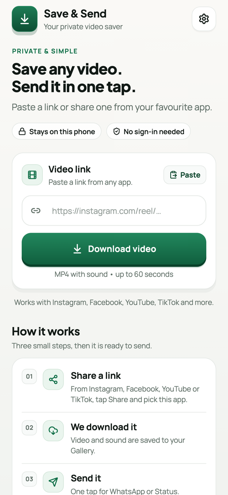
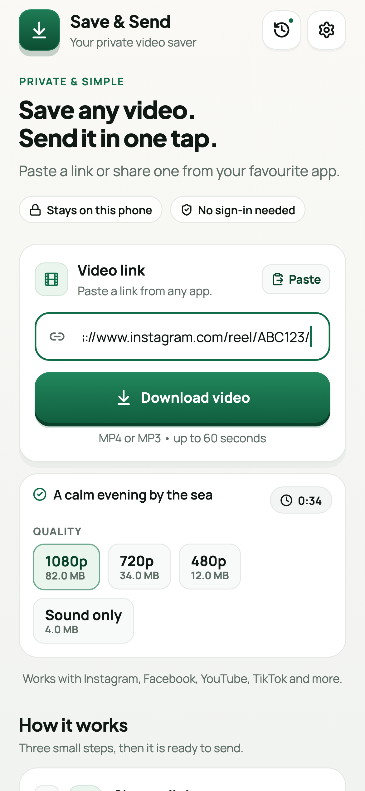
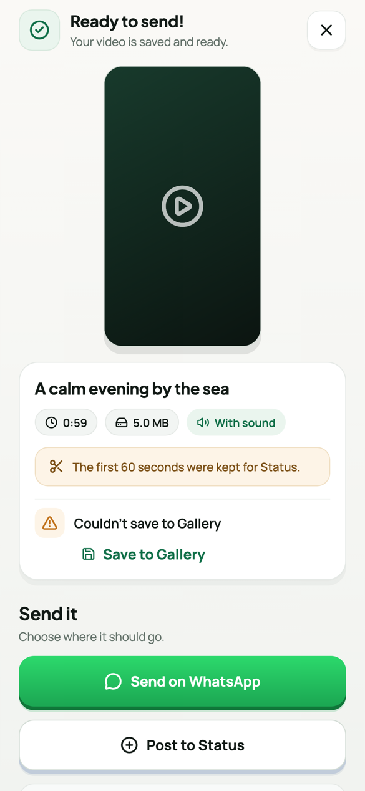
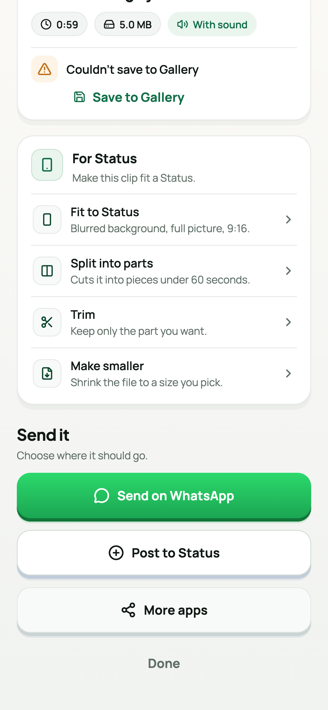
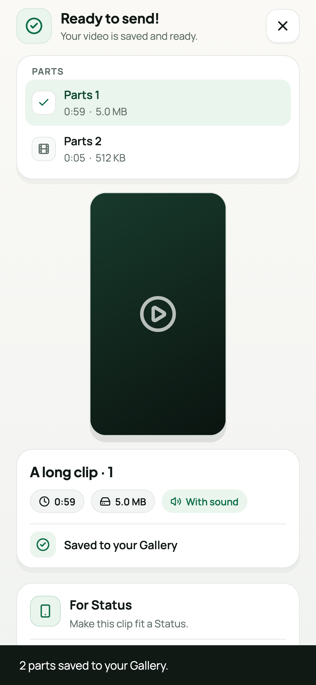
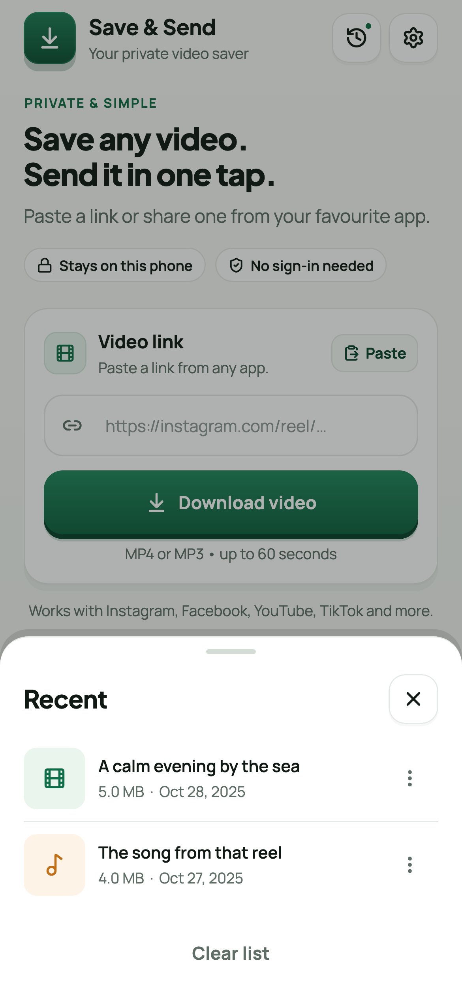
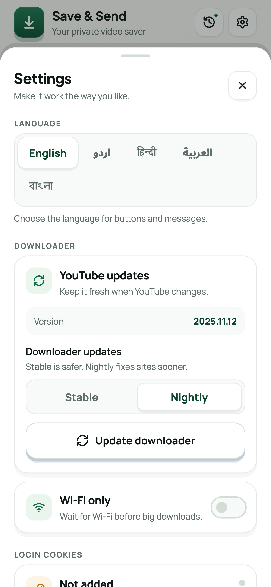
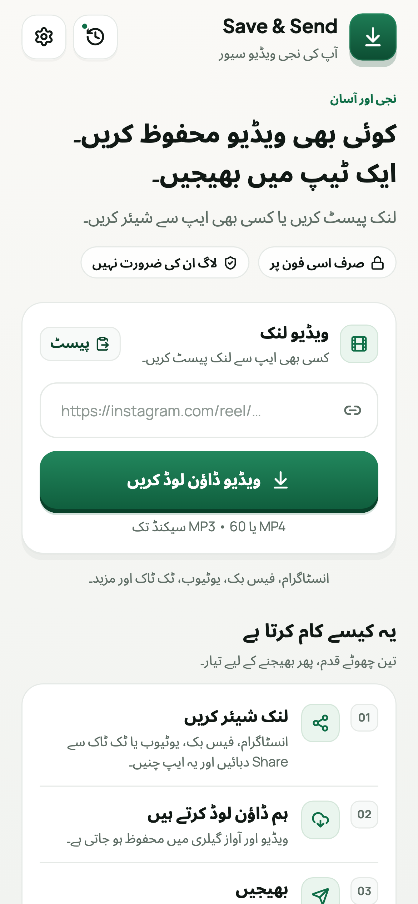
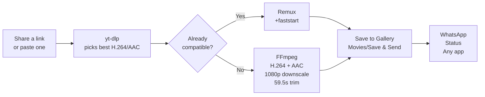

<div align="center">


<h1>Save &amp; Send</h1>

<p><strong>Save any video. Send it in one tap.</strong></p>

<p>A private, on-device Android app that turns a shared Instagram, Facebook, YouTube,<br/>
or TikTok link into a WhatsApp-ready MP4.</p>

<p>
  
  
  
  
  
  <a href="https://github.com/AdilSiddiquiHQ/save-and-send/actions/workflows/ci.yml"></a>
</p>

<p>
  <a href="https://github.com/AdilSiddiquiHQ/save-and-send/releases/latest"><strong>Download the latest APK →</strong></a>
  &nbsp;·&nbsp;
  <a href="docs/ARCHITECTURE.md">Architecture</a>
  &nbsp;·&nbsp;
  <a href="docs/ROADMAP.md">Roadmap</a>
  &nbsp;·&nbsp;
  <a href="docs/TRANSLATIONS.md">Translations</a>
  &nbsp;·&nbsp;
  <a href="CHANGELOG.md">Changelog</a>
  &nbsp;·&nbsp;
  <a href="PRIVACY.md">Privacy</a>
</p>

</div>

---

**Save & Send** is a small Android app built for one person. Share a public
video link from another app, or paste it into the composer. The app downloads
the video with sound, normalizes it to an MP4 that WhatsApp accepts, saves it to
your Gallery, and puts **Send on WhatsApp**, **Post to Status**, and **More
apps** one tap away.

There are no accounts, no ads, no analytics, no database, and no server. The
download engine runs entirely on the phone.

> **Why it exists:** WhatsApp Status wants a short, H.264/AAC MP4. Most
> downloaders hand you a WebM, a silent video, or a 4K file that WhatsApp
> refuses. Save & Send does the boring part — format selection, audio muxing,
> trimming, and `+faststart` — on-device.

## At a glance

| | |
| --- | --- |
| **Package** | `com.personal.save_and_send` |
| **Version** | 1.3.2 (8) |
| **Devices** | Android 7.0+ (API 24), `arm64-v8a` |
| **Output** | MP4 / H.264 / AAC-LC, ≤ 1920 px long edge, ≤ 59.5 s · MP3 192 kbps |
| **Interface** | English, Urdu, Hindi, Arabic, Bengali · Material 3 · RTL-aware |
| **Storage** | `Movies/Save & Send/`, `Music/Save & Send/`, app-private cache |
| **Backend** | None |

## Screenshots

These images are rendered by the widget test suite at phone size, so they show
the real layout and strings but not a real device. A photographed set is still
pending.

<table>
  <tr>
    <td align="center" width="25%">
      <br/>
      <sub><strong>Save a link</strong><br/>Share sheet or paste</sub>
    </td>
    <td align="center" width="25%">
      <br/>
      <sub><strong>Pick the size</strong><br/>Quality and MB before download</sub>
    </td>
    <td align="center" width="25%">
      <br/>
      <sub><strong>Ready to send</strong><br/>Preview, Gallery status, actions</sub>
    </td>
    <td align="center" width="25%">
      <br/>
      <sub><strong>For Status</strong><br/>Fit, split, trim, shrink</sub>
    </td>
  </tr>
  <tr>
    <td align="center" width="25%">
      <br/>
      <sub><strong>Every part</strong><br/>Send them in order</sub>
    </td>
    <td align="center" width="25%">
      <br/>
      <sub><strong>Recent</strong><br/>Open, re-send, or delete</sub>
    </td>
    <td align="center" width="25%">
      <br/>
      <sub><strong>Settings</strong><br/>Language, engine, Wi-Fi, cookies</sub>
    </td>
    <td align="center" width="25%">
      <br/>
      <sub><strong>اردو</strong><br/>Full RTL layout and typography</sub>
    </td>
  </tr>
</table>

## Features

- **Share-sheet intake.** Pick Save & Send from any app's Share menu. The app
  extracts the first usable link from the shared text, including messy captions.
- **One composer, no clutter.** Paste a link directly when you do not want to
  leave the app.
- **Pick before you download.** Once a link is pasted, the app reads its title,
  length, and estimated size for each quality up to 1080p. On mobile data, take
  480p instead of guessing.
- **Sound only.** Save the soundtrack as a 192 kbps MP3 in
  `Music/Save & Send` — useful for voice notes, reels, and music.
- **Real filenames.** The Gallery entry carries the video's own title, and
  WhatsApp shows that name instead of `SaveAndSend_20261028_…`.
- **Clipboard hand-off.** If a supported link is already copied, the home screen
  offers it with one tap. It never starts on its own.
- **Recent shelf.** The last 30 downloads, with a thumbnail, size, and date.
  Open, re-send, or delete without hunting through the Gallery.
- **Ready for Status.** One card after the download: fit a landscape clip into
  9:16 with a blurred background, split anything long into 59.5-second parts,
  trim to the part you want, or shrink the file to 8, 16, or 24 MB. Every
  result is saved to the Gallery and added to Recent, and the parts stay in
  order.
- **Sound, preserved.** Separate video and audio streams are merged, and the
  output is normalized to H.264 video and AAC-LC audio when the source has
  sound.
- **WhatsApp-safe output.** Videos longer than 59.5 seconds are trimmed to the
  first 59.5 seconds, and the MP4 is written with `+faststart` so it plays
  immediately when shared.
- **Gallery save built in.** Android 10+ uses MediaStore; Android 7–9 writes to
  `Movies/Save & Send`. A failed Gallery save does not lose the download — the
  result screen offers a retry.
- **Three share paths.** Send directly to WhatsApp, post to Status, or hand the
  file to any app through the system share sheet.
- **Inline preview.** Play, pause, mute, and check duration, size, and audio
  before sending.
- **Five interfaces, not five skins.** English, اردو, हिन्दी, العربية, and
  বাংলা, each with its own picker label, direction, and line-height rules. The
  choice is remembered between launches. [Translation notes](docs/TRANSLATIONS.md).
- **Self-healing engine.** The first launch extracts Python, FFmpeg, and yt-dlp,
  repairs native library links, and keeps the downloader updatable from
  Settings. Choose the Stable or Nightly channel, and run a redacted link check
  when a site stops working.
- **Wi-Fi only.** Hold big downloads until Wi-Fi is available, with a clear
  message instead of a silent failure.
- **Retry differently.** When a link fails, "Try another method" reruns it with
  a different player client and format ladder.
- **No background service.** Downloads run while the app is open, with the
  screen kept awake and a clear cancel path.

## How it works



1. **Intake.** Android delivers the shared text to `MainActivity`. The app finds
   and normalizes the URL — including Instagram `/share/` links, Facebook
   `fb.watch` short links, and numeric share links.
2. **Download.** The bundled yt-dlp tries a source-specific format ladder,
   preferring H.264 video and AAC audio at up to 1920 px. Transient extractor
   failures are retried with alternate clients and formats.
3. **Inspect.** Android's media APIs read duration, rotation, codecs, channel
   count, and dimensions.
4. **Normalize.** If the file is not already WhatsApp-friendly, FFmpeg re-encodes
   it to H.264/AAC, caps the long edge at 1080 px when needed, trims to 59.5
   seconds, and adds `+faststart`. If re-encoding fails, the pipeline falls back
   to stream copy and then to the raw download, so the video is never silently
   lost.
5. **Save and share.** The finished MP4 is copied to the Gallery and exposed to
   WhatsApp through a read-only `FileProvider` URI.
6. **Rescue it for Status (optional).** The result screen can re-encode the
   finished file: pad it to 9:16 with a blurred background, cut it into
   59.5-second parts, trim a range, or hit a target size with a bitrate budget.
   Each output is saved and listed, with its own share buttons.

For the full pipeline, channel contract, state machine, and storage map, see
[`docs/ARCHITECTURE.md`](docs/ARCHITECTURE.md).

## Supported sources

| Source | What works | Notes |
| --- | --- | --- |
| **Instagram** | Reels, posts, IGTV | Public content. `/share/reel/…` links are canonicalized. Login-gated posts may need cookies. |
| **Facebook** | Reels, Watch, videos | `fb.watch` and share tokens are resolved before download. Friends-only content needs cookies. |
| **YouTube** | Videos, Shorts | YouTube occasionally challenges downloads; update the engine in Settings or add cookies. |
| **TikTok** | Videos | Public content. |
| **Other sites** | Anything yt-dlp supports | The same normalization and sharing flow applies. |

Playlists are intentionally disabled: one link produces one video. DRM-protected
streams are not supported and are reported as errors.

## Requirements

**To install the APK**

- An `arm64-v8a` Android phone. This covers essentially every phone released
  since roughly 2017.
- Android 7.0 (API 24) or newer.
- About 70 MB for the APK and roughly 300 MB free for the first-run runtime
  extraction.
- Internet access.
- WhatsApp is optional. Without it, **More apps** still works.

**To build from source**

- Flutter 3.44.4 or newer (Dart 3.12.2).
- JDK 17.
- Android SDK with API 36 and the NDK version required by Flutter.
- An arm64 physical device for runtime testing. x86 emulators are excluded by
  the ABI filter.

## Install

1. Open the [latest release](https://github.com/AdilSiddiquiHQ/save-and-send/releases/latest)
   and download `SaveAndSend-v1.3.2-arm64.apk`.
2. Optionally verify the SHA-256 checksum published with the release.
3. Allow your browser or file manager to install unknown apps, then open the
   APK.
4. Launch Save & Send. The first start extracts the bundled runtime; this takes
   roughly 10–60 seconds depending on the phone.
5. Share a link to the app, or paste one into the composer.

> If you previously installed a build signed with a different key, uninstall it
> first. Android refuses to update an app whose signing certificate changed.

### Upgrading and downgrading

- **Upgrade:** install the new APK over the old one. Gallery files, Recent,
  language, Wi-Fi preference, and cookies are kept.
- **Downgrade:** Android refuses an APK with a lower `versionCode`. Uninstall
  first, which also removes Recent, settings, and cookies. Files already in the
  Gallery are untouched.
- **Signing key changed:** Android reports "App not installed" until the old
  copy is uninstalled.

## Where files live

| What | Path or store | Survives uninstall? |
| --- | --- | --- |
| Videos | `Movies/Save & Send/` through MediaStore | Yes |
| Sound-only MP3s | `Music/Save & Send/` through MediaStore | Yes |
| Status outputs | Gallery, with the rest of the videos | Yes |
| Recent list and settings | App-private SharedPreferences | No |
| Login cookies | `filesDir/cookies.enc`, Keystore-encrypted | No |
| Working files | `cacheDir/downloads`, `cacheDir/transforms`, `cacheDir/frames` | No |

Settings → **Storage** shows how much the cache is holding and clears it in one
tap. Clearing it does not touch the Gallery.

## Build from source

### What you need

| Tool | Version used for the release |
| --- | --- |
| Flutter | 3.44.4 (stable), Dart 3.9 |
| JDK | 17 |
| Android SDK | platform 36, build-tools 37.0.0 |
| NDK | the version `flutter.ndkVersion` resolves to (27.x with Flutter 3.44) |
| Signing | optional `android/key.properties`, see below |

`flutter doctor` should show an accepted Android toolchain. The build does not
need a connected device.

```bash
git clone https://github.com/AdilSiddiquiHQ/save-and-send.git
cd save-and-send

flutter pub get
flutter analyze
flutter test test/app_test.dart test/widget_test.dart test/l10n_test.dart

flutter build apk --release --target-platform android-arm64
```

The APK is written to:

```text
build/app/outputs/flutter-apk/app-release.apk
```

Copy it to a predictable name before sharing:

```bash
cp build/app/outputs/flutter-apk/app-release.apk \
   SaveAndSend-v1.3.2-arm64.apk
```

The repository deliberately keeps only `arm64-v8a`. The Python and FFmpeg
runtimes are large; adding other ABIs would multiply the APK size for devices
that cannot run current WhatsApp comfortably anyway.

### Release signing

A fresh clone builds with Flutter's local debug key so the project works out of
the box. **Do not distribute a debug-signed APK.** To sign with your own key:

```bash
KEYSTORE="$HOME/.config/save-and-send/save-and-send-release.jks"
mkdir -p "$(dirname "$KEYSTORE")"

keytool -genkeypair -v \
  -keystore "$KEYSTORE" \
  -alias save-and-send \
  -keyalg RSA -keysize 4096 -validity 10000
```

Then copy the example configuration and fill it in:

```bash
cp android/key.properties.example android/key.properties
```

```properties
storePassword=your-store-password
keyPassword=your-key-password
keyAlias=save-and-send
storeFile=/absolute/path/to/save-and-send-release.jks
```

Rebuild, then verify the certificate:

```bash
flutter build apk --release --target-platform android-arm64
apksigner verify --print-certs \
  build/app/outputs/flutter-apk/app-release.apk
```

Keep the keystore and `android/key.properties` backed up and private. They are
ignored by git and must never be committed or attached to a release.

## Usage

### Share from another app

1. Open a public video in Instagram, Facebook, YouTube, TikTok, or another
   supported app.
2. Tap **Share** and choose **Save & Send**.
3. The app starts downloading immediately. Keep the screen open.

### Paste a link

1. Copy a video link.
2. Open Save & Send and tap **Paste**.
3. Tap **Download video**.

### On the result screen

| Action | What it does |
| --- | --- |
| **Send on WhatsApp** | Opens WhatsApp's share flow with the MP4. |
| **Post to Status** | Opens WhatsApp Status directly when supported; otherwise falls back to the contact picker. |
| **More apps** | Opens the Android share sheet for any installed app. |
| **Save to Gallery** | Retries the Gallery copy if the first attempt failed. |
| **Done** | Closes the activity. The Gallery copy remains. |

Downloads are saved as
`Movies/Save & Send/SaveAndSend_YYYYMMDD_HHMMSS.mp4`.

## Settings

Open the gear icon on the home screen.

- **Language** — English, اردو, हिन्दी, العربية, or বাংলা. The choice is stored
  locally and applied before the first frame on the next launch.
- **Downloader updates** — shows the engine version and updates it in place.
  **Stable** is the safer channel; **Nightly** fixes a broken site sooner. The
  APK itself does not change, so a site fix does not need a new install. Use
  this first when a link that worked last week starts failing.
- **Storage** — shows how much the download cache, Status copies, and preview
  frames are using, with a one-tap clear. Gallery copies are never touched.
- **Login cookies** — optional. Paste a Netscape `cookies.txt` file or raw
  `name=value` cookie pairs. The app converts them and stores them in private
  app storage. Use this only for content that genuinely requires a session.
  Remove them with one tap.
- **About** — version and a short personal-use notice.

## Privacy and security

Save & Send is designed to keep your data on your phone.

| Data | Where it lives | Leaves the phone? |
| --- | --- | --- |
| Downloaded video | App cache, then Gallery | Only when you share it |
| Login cookies | `filesDir/cookies.enc`, encrypted with an Android Keystore key | Only to the source site through yt-dlp |
| Language preference | App-private SharedPreferences | No |
| Analytics or identifiers | Not collected | No |
| Accounts | None | No |
| Save & Send server | None exists | No |

Additional boundaries:

- `android:allowBackup="false"` keeps cookies and app state out of cloud
  backups.
- Shared files are exposed through a non-exported `FileProvider` with
  per-intent read permission. There is no public file server.
- Cookies are decrypted into `cacheDir/cookies.txt` only while a request runs,
  and that copy is deleted when it finishes. The key never leaves the Android
  Keystore. A plaintext `cookies.txt` from an older version is encrypted and
  removed on first use.
- Cleartext HTTP is refused at the manifest level, so a future change cannot
  silently downgrade a download or a thumbnail.
- No ads, trackers, crash reporters, or analytics SDKs.
- The downloader talks directly to the source platform. Updating yt-dlp contacts
  the update endpoint configured by youtubedl-android.

### Permissions

| Permission | Why it is there |
| --- | --- |
| `INTERNET` | Fetch the page and download the video |
| `ACCESS_NETWORK_STATE` | Answer "am I on Wi-Fi?" for the Wi-Fi-only setting |
| `WRITE_EXTERNAL_STORAGE` (`maxSdkVersion="28"`) | Save into the Gallery on Android 7–9; Android 10+ uses MediaStore and needs no permission |

There is no location, contacts, microphone, camera, notification, or
background-service permission. The screen stays awake during a download with
`FLAG_KEEP_SCREEN_ON`, which needs no permission.

See [`SECURITY.md`](SECURITY.md) for reporting a vulnerability.

## Troubleshooting

| Symptom | Likely cause | Fix |
| --- | --- | --- |
| **"Couldn't start the downloader"** | First-run extraction failed, or storage is full | Free space, tap **Try again**, then reinstall if it persists. |
| **"YouTube is blocking this download"** | YouTube bot or sign-in challenge | Update the downloader in Settings, or add YouTube cookies. |
| **"This video needs a login"** | Private, friends-only, or age-gated content | Add cookies for that platform, or use a public link. |
| **"No link found"** | The shared text had no URL | Copy the link itself, or share from the video's Share menu. |
| **Download is very slow** | Source throttling or a long video | Wait, or try a shorter public clip. Only one download runs at a time. |
| **"There isn't enough storage"** | Cache or Gallery is full | Free space; the app needs room for both the working file and the Gallery copy. |
| **Status button opens a contact picker** | The installed WhatsApp lacks the Status deep link | Pick a contact, or update WhatsApp. **Send on WhatsApp** still works. |
| **APK will not install** | Wrong ABI or a signing-key mismatch | Use an arm64 phone running Android 7+, and uninstall any older copy first. |
| **App closes during a long download** | Android reclaimed the activity; there is no foreground service | Keep the app open. Reopen and retry; partial downloads are discarded. |
| **Build fails on NDK or SDK** | Toolchain not installed | Install API 36, build tools, and the NDK through Android Studio's SDK Manager. |

If a download fails, open **Details** on the error screen and include the code
in a bug report. Remove personal links and cookies first.

### Reporting a broken link

If one link fails while others work, that is usually yt-dlp falling behind a
site change. Useful reports include:

1. The link (public posts only).
2. The app version from Settings.
3. The text behind **Details** on the error screen, or the output of
   **Run link check** in Settings.

The Details text is already redacted: cookie values, local paths, and header
lines are removed. Paste it into a [new
issue](https://github.com/AdilSiddiquiHQ/save-and-send/issues/new?template=broken-link.yml).

## Tech stack

| Layer | Choice |
| --- | --- |
| UI | Flutter 3.44.4, Material 3, Dart 3.12.2 |
| Visual system | Manrope, Plus Jakarta Sans, Noto Sans Arabic, Lucide icons |
| Native shell | Kotlin 2.3.20, Android Gradle Plugin 9.0.1, Gradle 9.1.0 |
| Download engine | [youtubedl-android](https://github.com/JunkFood02/youtubedl-android) 0.18.1 |
| Extractor | [yt-dlp](https://github.com/yt-dlp/yt-dlp) 2026.10.26 |
| Media processing | FFmpeg (bundled with youtubedl-android) |
| Preview | `video_player` |
| Storage | MediaStore / direct Movies directory |
| State | A single Flutter `Phase` state machine + platform event stream |

## Project layout

```text
save-and-send/
├── android/
│   ├── app/src/main/
│   │   ├── kotlin/com/personal/save_and_send/
│   │   │   ├── MainActivity.kt        # share intake, Gallery, intents
│   │   │   ├── Downloader.kt          # yt-dlp + FFmpeg pipeline
│   │   │   ├── TransformPlanner.kt    # Status math, FFmpeg args, cache cap
│   │   │   ├── CookieStore.kt         # Keystore-encrypted cookie jar
│   │   │   └── NativeLibraryHelper.kt # runtime library repair
│   │   ├── res/raw/ytdlp              # bundled yt-dlp zipapp
│   │   └── AndroidManifest.xml
│   └── key.properties.example         # release signing template
├── assets/fonts/                      # OFL fonts + license texts
├── docs/
│   ├── ARCHITECTURE.md
│   ├── ROADMAP.md
│   └── screenshots/
├── lib/
│   ├── main.dart
│   ├── l10n/                          # one ARB file per language
│   │   ├── app_en.arb                 # template
│   │   ├── app_ur.arb
│   │   ├── app_hi.arb
│   │   ├── app_ar.arb
│   │   └── app_bn.arb
│   └── src/
│       ├── app.dart
│       ├── home_screen.dart           # state machine and screens
│       ├── settings_sheet.dart
│       ├── design.dart                # cards, buttons, brand mark
│       ├── theme.dart                 # palette and typography
│       ├── i18n.dart                  # language list + error/stage mapping
│       ├── l10n/                      # generated by flutter gen-l10n
│       ├── models.dart
│       └── native.dart                # platform channel wrapper
├── test/
│   ├── app_test.dart
│   ├── widget_test.dart
│   ├── l10n_test.dart                 # ARB keys, placeholders, copy
│   ├── visual_test.dart
│   └── goldens/
├── tool/
│   ├── release.sh                     # build, checksum, tag, publish
│   ├── check_l10n.py                  # every key exists and reaches the UI
│   ├── sbom.py                        # per-release CycloneDX SBOM
│   ├── ytdlp-version.txt              # bundled yt-dlp, checked monthly
│   └── make_icons.py
└── .github/workflows/                 # CI, monthly engine check
```

## Testing

```bash
# Static analysis
flutter analyze

# Every ARB key exists, is generated, and is used from lib/src
python3 tool/check_l10n.py

# Android logic: Status splitting, bitrate budget, cache pruning
cd android && ./gradlew :app:testDebugUnitTest

# Behavior and widget coverage
flutter test test/app_test.dart test/widget_test.dart test/l10n_test.dart

# Full suite, including platform-sensitive golden screenshots
flutter test

# Regenerate goldens after an intentional visual change
flutter test test/visual_test.dart --update-goldens
```

The test suite covers the idle screen, a full progress-to-result flow, settings,
Urdu and Arabic on a narrow screen with large text, layout mirroring, switching
language from the picker, and every ARB file (keys, placeholders, and leftover
English). Golden tests use the real Manrope, Plus Jakarta Sans, Noto Sans Arabic,
and Lucide fonts, plus the macOS Devanagari and Bengali faces for the language
picker, which is why they are kept as local visual references rather than run on
every CI platform.

CI runs `flutter analyze`, the behavior tests, the Kotlin tests, the translation
check, and a release build that must stay under 68 MiB with only
`arm64-v8a` libraries.

## FAQ

**Why 59.5 seconds and not 60?**
WhatsApp rejects anything at or over a minute once container overhead is added.
59.5 s leaves a small margin. **Split into parts** cuts at exactly that length.

**Why 1080p and not 4K?**
Status recompresses everything to roughly 1080p, so a 4K download costs time,
battery, and storage for pixels you never see. The picker caps at 1080p on
purpose.

**Why does the file size differ from the estimate?**
The picker estimates from the source bitrate. The app re-encodes to H.264/AAC
and trims to 59.5 s, so the saved file is usually smaller. Treat the number as
a guide, not a promise.

**Why do the Status tools re-encode?**
Fit, split, trim, and shrink all write a new H.264 file because that is the only
way to change the picture, the length, or the size. Each pass softens the image
a little, which is why the card says so and why actions that would change
nothing are disabled.

**Why does a link fail when the same site worked yesterday?**
Sites change their pages constantly. Tap **Update downloader** in Settings
first. If it still fails, run **Run link check** and send the Details text.

**Why arm64 only?**
The bundled Python and FFmpeg runtimes are large. Shipping one ABI keeps the APK
around 68 MB and covers every phone that runs current WhatsApp comfortably.

**Does it work without Google Play Services?**
Yes. Nothing depends on it. It does need a network connection, because the
video is fetched when you ask for it.

**Where do I change the quality or get only the sound?**
Paste a link; the picker appears under the composer with heights, estimated
sizes, and **Sound only**. The choice is passed to yt-dlp, not applied after the
download.

## Limitations

- **arm64 only.** The bundled Python/FFmpeg runtime is built for `arm64-v8a`.
- **One download at a time.** The app rejects a second concurrent request rather
  than corrupting the shared runtime.
- **No foreground service.** A download stops if Android kills the activity.
  This is intentional: no persistent notification and no background battery
  drain.
- **Public content only.** Private, friends-only, age-restricted, and DRM
  content is not bypassed. Cookies can help with some login-gated public posts,
  but they are not a guarantee.
- **Platform drift.** Instagram, Facebook, YouTube, and TikTok change their
  pages regularly. yt-dlp updates from Settings are the intended remedy.
- **Status deep link varies.** Some WhatsApp builds do not expose a direct
  Status intent; the app falls back to WhatsApp's contact picker.
- **No playlists or batch mode.** One link, one video.
- **No release signing key in the repository.** Builds are debug-signed unless
  you provide `android/key.properties`.

## Legal

Save & Send is a personal tool, not a content service. Only download videos you
own or have permission to save. Respect copyright, the terms of service of each
platform, and the privacy of the people in the videos. The app does not
circumvent DRM and is not affiliated with Meta, Google, ByteDance, or WhatsApp.

Downloaded videos remain the property of their respective owners. The software
license does not grant rights to downloaded content.

## License

Save & Send is **source-available, personal use only**. The original code, the
interface text, the translations, the icon, the screenshots, and the
documentation are covered by the [Save & Send Personal Use
License](LICENSE).

In short: install it on your own devices, read it, and change it for yourself.
Do not redistribute it, publish it to any app store, or sell it. The name,
icon, and package name belong to the project.

Official builds come from this repository's releases page only. There is no
Play Store listing, and nobody else is authorised to publish one.

### Bundled GPL components

The APK includes GPL-3.0 libraries — youtubedl-android and its FFmpeg build.
Those components keep their own licenses, and a distributed APK carries the
GPL's obligations for them, including source availability. The personal-use
terms above add no restriction on the rights the GPL gives you for those parts;
they apply to the original code and to any build without them. The exact
components, versions, and links are in
[`THIRD_PARTY_NOTICES.md`](THIRD_PARTY_NOTICES.md).

In practice this means a license cannot stop someone who already has the APK
from copying it, because the bundled GPL parts allow that. What the license and
the branding do give you is a clear basis to report an impostor listing and to
ask a store to take it down.

Releases up to and including 1.3.0 were published under GPL-3.0 and remain
available under that license. The personal-use license applies to the source
from this commit onward.

## Acknowledgements

- [yt-dlp](https://github.com/yt-dlp/yt-dlp), [youtubedl-android](https://github.com/JunkFood02/youtubedl-android), and [FFmpeg](https://ffmpeg.org/) for the download and media engine.
- [Flutter](https://flutter.dev/) and the Dart team.
- [Lucide](https://lucide.dev/) for the icon set.
- The Manrope, Plus Jakarta Sans, and Noto Sans Arabic type designers.
- Everyone who keeps open-source extractors alive when platforms change.

---

<div align="center">
  <sub>Built for one phone. Shared in case it helps yours.</sub>
</div>
