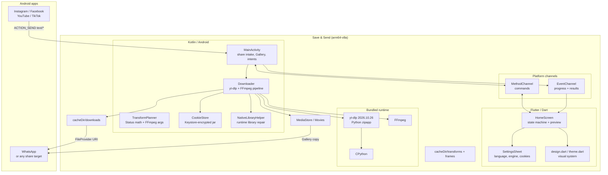
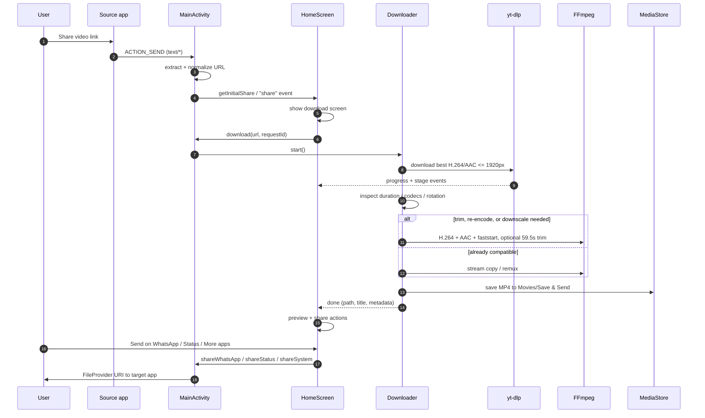

# Architecture

Save & Send is a thin Flutter interface over a native Android download and
media-processing pipeline. The design favors a small, auditable surface: no
backend, no database, no background service, and no third-party analytics.

## System overview



## Request lifecycle



## Flutter state machine

`HomeScreen` owns a single `Phase` value:

```text
booting ──► idle ──► preparing ──► downloading ──► result
   │          │                         │            │
   │          └──────── error ◄─────────┘            │
   │                                                 ▼
   │                              result ◄── transforming
   └──► engineError ──► retrySetup ──► booting
```

- `booting` — engine extraction and first-frame warm-up.
- `idle` — link composer, trust notes, three-step explainer.
- `preparing` / `downloading` — progress ring, stage copy, cancel action.
- `result` — inline preview, metadata, Gallery status, For Status tools,
  share actions, and a part list after a split.
- `transforming` — FFmpeg progress while a Status fit, split, trim, or compress
  runs. Cancel kills the process. A failed or cancelled transform returns to
  the result it came from.
- `error` — localized message, optional native detail, retry and share-link
  actions.
- `engineError` — startup failure with a retry path.

Events carry a `requestId`; stale events from a previous download are ignored.
A shared link that arrives while a download is running is held in
`_pendingUrl` rather than replacing the active request.

## Platform channel contract

`lib/src/native.dart` exposes a typed wrapper around two channels.

### MethodChannel `com.personal.save_and_send/native`

| Method | Arguments | Returns |
| --- | --- | --- |
| `getInitialShare` | — | `{url?, error?}` |
| `ensureEngine` | — | `{version, cookies}` |
| `download` | `url`, `requestId`, `options` | `null` |
| `transform` | `path`, `title`, `mode`, `requestId`, `startMs`, `endMs`, `targetBytes` | `null` |
| `cancel` | — | `null` |
| `shareWhatsApp` | `path` | `ok` / `chat` / `not_installed` / `missing` / `failed` |
| `shareStatus` | `path` | `ok` / `chat` / `not_installed` / `missing` / `failed` |
| `shareSystem` | `path` | `ok` / `missing` / `failed` |
| `shareText` | `text` | `ok` / `failed` |
| `saveToGallery` | `path` | `bool` |
| `closeApp` | — | `null` |
| `setScreenOn` | `on` | `null` |
| `updateEngine` | — | `{status, version}` |
| `engineVersion` | — | `String` |
| `hasCookies` | — | `bool` |
| `setCookies` | `text` | `bool` |
| `getPref` | `key` | `String?` |
| `setPref` | `key`, `value` | `null` |

### EventChannel `com.personal.save_and_send/events`

| `type` | Payload |
| --- | --- |
| `share` | `url` or `error` |
| `stage` | `stage`, optional `attempt` |
| `progress` | `percent` (0–100), `etaSeconds` |
| `gallery` | `saved` |
| `done` | `path`, `title`, `durationMs`, `width`, `height`, `hasAudio`, `thumbnailPath`, `thumbnailUrl`, `trimmed`, `sizeBytes`, `uri`, `savedPath`, `kind` |
| `transformed` | `items`: one map per output with `path`, `title`, `durationMs`, `width`, `height`, `hasAudio`, `sizeBytes`, `uri`, `savedPath`, `kind` |
| `error` | `code`, `message`, `detail` |
| `cancelled` | — |

Events emitted before Dart subscribes are queued in `MainActivity` and flushed
on `onListen`.

## Download pipeline

### 1. Link intake

`MainActivity.extractUrl` accepts plain URLs, friendly share text, and bare
domains. It:

- finds the first `http(s)` URL or a known social domain;
- trims trailing punctuation;
- expands Instagram `/share/reel/…` links to canonical `/reel/…/` URLs;
- rewrites numeric Facebook share links to `/reel/…` or `/watch/?v=…`;
- resolves `fb.watch` and Facebook share tokens with a short redirect/Open
  Graph crawl, bounded to six hops and four-second timeouts.

The `Downloader` repeats normalization as a defense-in-depth measure, so a
request that bypasses the activity still gets a canonical URL.

### 2. Work directory

Each request gets `cacheDir/downloads/<requestId>/`. Old request folders are
deleted before a new download starts. Only the finished `final.mp4`, the
thumbnail, and `video.info.json` remain after post-processing; the raw download
is removed.

Status outputs live in `cacheDir/transforms/<requestId>/`. They are kept so a
part can be re-shared or fed into another tool, but the whole folder set is
pruned to 250 MB (`TransformPlanner.CACHE_BYTES`) before each transform. The
oldest folders go first, and the folder that holds the current input is never
removed — that was a bug in 1.3.0 that `TransformPlannerTest` now covers.

### 3. Format selection

The default yt-dlp format ladder prefers a playable pair before falling back to
convenience:

```text
bv*[width<=1920][height<=1920][vcodec^=avc1]+ba[acodec^=mp4a]
  / b[width<=1920][height<=1920][ext=mp4]
  / best[ext=mp4]
  / bv*[width<=1920][height<=1920]+ba
  / b[width<=1920][height<=1920]
  / b
```

Source-specific attempts are layered on top:

- **YouTube** — default, alternative player clients
  (`android_vr,web_safari,tv`), then best available.
- **Instagram** — default, MP4-first with an Instagram referer, then best.
- **Facebook** — `hd`/`sd`-style best selection, then `b/best`.
- **Everything else** — default, then best.

Requests use `--merge-output-format mp4`, `--no-playlist`, `--write-info-json`,
`--write-thumbnail`, three retries, four concurrent fragments, a 20-second
socket timeout, and a Chrome desktop user agent. A cookies file is added only
when one exists.

Retries happen only for transient or extractor-shape errors (for example
"requested format is not available", HTTP 401/403, or YouTube bot checks).
Permanent failures such as "private", "unsupported URL", or "video unavailable"
fail immediately with a classified error.

### 4. Inspection

`MediaMetadataRetriever` and `MediaExtractor` read duration, rotation, display
dimensions, audio presence, MIME types, and channel count. If Android cannot
read the duration, the duration from `video.info.json` is used.

### 5. Post-processing decision

A file is re-encoded when any of these is true:

- video is not H.264;
- audio is not AAC-LC or has more than two channels;
- the container is not MP4/M4V/MOV;
- the longest display edge exceeds 1920 px;
- the video is longer than 59,500 ms.

Otherwise it is remuxed with stream copy. FFmpeg is invoked directly from
`nativeLibraryDir/libffmpeg.so` with `LD_LIBRARY_PATH` pointing at the repaired
runtime libraries.

Re-encode settings:

```text
libx264, preset veryfast, CRF 23, yuv420p
AAC 128k, stereo (when audio exists)
scale long edge to 1080 when the source exceeds 1920
-t 59.5 when trimming
-movflags +faststart
-map 0:v:0 -map 0:a:0?
```

If a full re-encode fails, the pipeline retries with stream copy and trimming.
If that also fails, it copies the raw download so the user does not lose the
video. Every successful output is checked for a non-zero size.

### 6. Gallery and sharing

On Android 10+, the file is inserted into
`MediaStore.Video.Media` with `RELATIVE_PATH = Movies/Save & Send` and
`IS_PENDING` set until the copy completes. On Android 7–9, the app writes to
the public Movies directory and runs `MediaScannerConnection`.

Sharing uses a `FileProvider` authority of
`com.personal.save_and_send.fileprovider`, with cache and files paths exposed
read-only per intent. WhatsApp is detected as `com.whatsapp` or
`com.whatsapp.w4b`. Status sharing sends an `ACTION_VIEW` intent to
`https://wa.me/status` with `share_type=SHARE_TO_STATUS`; if the installed
WhatsApp does not handle it, the app falls back to the WhatsApp contact picker.

## Engine startup

`ensureEngineReady()` runs once, off the main thread:

1. Initialize the FFmpeg and YoutubeDL Android wrappers.
2. Copy the bundled yt-dlp binary from `res/raw/ytdlp` when the stored version
   differs from `EngineInfo.YTDLP_VERSION` or the file size does not match the
   asset. The asset itself is the source of truth, and `EngineInfoTest` fails
   the build when the version string and the zipapp disagree.
3. Repair native library dependencies with `NativeLibraryHelper`.

`NativeLibraryHelper` copies `libc++_shared.so` into the extracted Python and
FFmpeg trees, restores libraries that Android packaged as text symlinks, and
grants read/execute permission. `getLdLibraryPath()` returns the FFmpeg, Python,
aria2c, and native library directories for child processes.

This exists because Android's packaging and the youtubedl-android extraction
layout do not always preserve symlinks and executable bits across devices and
installers.

## Storage layout

| Location | Contents | Lifetime |
| --- | --- | --- |
| `cacheDir/downloads/<requestId>/` | Working video, thumbnail, info JSON | Until the next download or cleared in Settings |
| `cacheDir/transforms/<requestId>/` | Status-encoded outputs | Pruned oldest-first to 250 MB |
| `cacheDir/frames/` | Trim-preview JPEGs | Until cleared in Settings |
| `filesDir/cookies.enc` | Optional cookie jar, AES-GCM with a Keystore key | Until removed in Settings |
| `cacheDir/cookies.txt` | Temporary plaintext jar for yt-dlp | Only during a request |
| `noBackupFilesDir/youtubedl-android/` | Extracted Python, FFmpeg, yt-dlp | App install (not backed up) |
| `Movies/Save & Send/` | Finished MP4 copies | Until the user deletes them |
| SharedPreferences `save_and_send` | Language and `has_run` flag | App data |

Cookies are written to `filesDir/cookies.enc`. During a request they are
decrypted into `cacheDir/cookies.txt` and deleted in a `finally` block, so a
crash cannot leave an unlocked jar behind on the next launch. A plaintext
`cookies.txt` from 1.3.0 or earlier is encrypted and removed on first use.

`android:allowBackup="false"` keeps cookies and app state out of cloud backups.
The Gallery copy is independent of the app and survives uninstalling.

## Concurrency and lifecycle

- One download or Status transform at a time, enforced by the same
  `AtomicBoolean` in `Downloader` and a second guard in `MainActivity`.
- Downloads run on a single-thread executor plus a dedicated worker thread.
- `FLAG_KEEP_SCREEN_ON` is set while a download or transform is active and
  cleared on `done`, `transformed`, `error`, or `cancelled`.
- There is no foreground service. If Android kills the activity during a long
  download, the request is cancelled rather than resumed.
- `PopScope` asks for confirmation before leaving during a download.
- Video preview is disposed when the result screen is left or the app is
  backgrounded.

## Localization

Messages live in `lib/l10n/app_<locale>.arb`. The English file is the template;
`flutter gen-l10n` (wired through `l10n.yaml` and `generate: true`) writes the
`AppLocalizations` classes into `lib/src/l10n/`.

- `AppLanguage.all` in `lib/src/i18n.dart` is the single list of shipped
  languages, their codes, and their native labels.
- `AppStrings` (same file) maps the native error and stage codes to strings, so
  the Kotlin side never sends display text.
- Right-to-left layout comes from the locale through `GlobalWidgetsLocalizations`;
  only the video overlay and the optional script fallbacks need manual handling.
- `test/l10n_test.dart` compares every ARB file with the template: same keys, no
  empty message, same placeholders, and no accidentally copied English.

## Error taxonomy

Native errors are mapped to stable codes, then localized through the ARB files.

| Code | Meaning |
| --- | --- |
| `busy` | A download is already running |
| `network` | DNS, connection, timeout, or unreachable host |
| `login` | Platform requires a session or cookies |
| `private` | Friends-only or private content |
| `age` | Age-restricted content |
| `youtube_block` | YouTube bot/sign-in challenge |
| `unsupported` | URL is not handled by yt-dlp |
| `unavailable` | Removed or deleted video |
| `not_found` | Expired or missing link |
| `drm` | Protected content |
| `no_video` | No downloadable format found |
| `processing` | Download succeeded but FFmpeg failed |
| `storage` | No space or unwritable destination |
| `engine` | Runtime failed to start |
| `no_link` | Shared text contained no usable URL |
| `generic` | Fallback |

The error screen can reveal the raw native detail behind a "Details" toggle.
That text is target/tool output and is never used as an instruction.

## Testing

- `test/app_test.dart` mocks both platform channels and drives the idle,
  progress, result, settings, Urdu/Hindi/Arabic, narrow-screen, and large-text
  paths.
- `test/widget_test.dart` checks each language resolves, error-code mapping, and
  the time-left placeholder.
- `test/l10n_test.dart` keeps every ARB file in step with the English template.
- `test/visual_test.dart` renders golden screenshots with real fonts and Lucide
  glyphs loaded.
- `flutter analyze` is kept clean; CI runs analyze plus the behavior tests.

## Design boundaries

- **No backend.** Every operation happens on the device.
- **No persistence of media metadata.** The app does not index downloads or
  build a library.
- **No background service.** The user is expected to keep the app open while a
  download finishes.
- **No DRM bypass.** Protected streams are reported as errors.
- **No automatic retries across app launches.** A failed request is retried only
  when the user asks.
