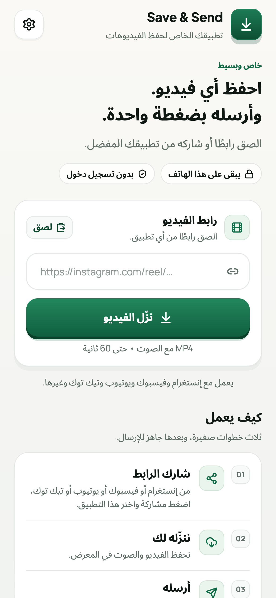

# Translations

The app ships five interfaces: English, Urdu, Hindi, Arabic, and Bengali.
Translation is not a word-for-word exercise here — an interface that reads like
a manual is worse than one that stays in English.

## How it is wired

| Piece | Where |
| --- | --- |
| Messages | `lib/l10n/app_<locale>.arb` |
| Generator config | `l10n.yaml` |
| Generated class | `lib/src/l10n/app_localizations*.dart` (do not edit) |
| Language list | `AppLanguage` in `lib/src/i18n.dart` |
| Engine and API error codes | `AppStrings` in `lib/src/i18n.dart` |

`app_en.arb` is the template. Every other file must have exactly the same keys;
`test/l10n_test.dart` fails the build when one is missing, empty, or when a
placeholder such as `{time}` was dropped.

```bash
flutter gen-l10n                     # regenerate after editing an ARB file
flutter test test/l10n_test.dart     # key, placeholder, and copy checks
python3 tool/check_l10n.py           # every key exists, is generated, and is used
```

`check_l10n.py` is the CI gate. It fails when a language is missing a key, when
the generated Dart was not refreshed after an ARB edit, and when a key was added
but no screen ever reads it. There are 187 keys in each of the five files.

Generated Dart is committed so `flutter analyze` works in a fresh clone.

## The voice

Write the way a 25-year-old in that language actually talks in a phone app, not
the way a textbook or a press release does.

- **Translate the meaning, then say it again in your own words.** If the literal
  sentence sounds like a translated sentence, rewrite it.
- **Keep English loanwords that people really use.** Hindi and Bengali speakers
  say *video*, *link*, *save*, *download*, *settings*, *status*, *cookie*. Do not
  replace them with stiff formal equivalents whose only home is a government
  form.
- **Use the imperative you would use with a friend.** Hindi/Bengali `करें`/`করুন`
  (polite), Urdu `کریں`, Arabic `افعل` without bureaucratic padding.
- **Stay short.** These strings sit inside buttons, chips, and a progress card.
  A translation that is 40% longer than the English will overflow.
- **No calques.** "Make it work the way you like" is not "اجعله يعمل بالطريقة
  التي تحبها" — it is "اجعله يناسبك."
- **Keep the brand and the URL.** `Save & Send` and `https://instagram.com/reel/…`
  stay as they are.
- **Never machine-translate and ship.** Every string in a new language needs one
  human read-through by someone who speaks it as their first language.

### What "bookish" looks like

| Too formal | What people actually say |
| --- | --- |
| Hindi: वीडियो को संग्रहित करें | वीडियो सेव करें |
| Hindi: डाउनलोडिंग प्रक्रिया जारी है | वीडियो डाउनलोड हो रहा है |
| Bengali: ভিডিওটি সংরক্ষণ করুন | ভিডিওটা সেভ করুন |
| Bengali: ডাউনলোড সম্পন্ন হইয়াছে | ডাউনলোড হয়ে গেছে |
| Arabic: يتعذّر عليك تنزيل هذا المقطع | تعذّر تنزيل هذا الفيديو |
| Urdu: ویڈیو محفوظ کرنے کا عمل جاری ہے | ویڈیو محفوظ ہو رہی ہے |

### Glossary

Keep these terms consistent inside a language. Changing one mid-app is what
makes a translation feel machine-made.

| English | Urdu | Hindi | Arabic | Bengali |
| --- | --- | --- | --- | --- |
| video | ویڈیو | वीडियो | فيديو | ভিডিও |
| link | لنک | लिंक | رابط | লিংক |
| download | ڈاؤن لوڈ | डाउनलोड | تنزيل | ডাউনলোড |
| save | محفوظ کریں | सेव करें | احفظ | সেভ করুন |
| Gallery | گیلری | गैलरी | المعرض | গ্যালারি |
| sound | آواز | आवाज़ | الصوت | সাউন্ড |
| Settings | ترتیبات | सेटिंग्स | الإعدادات | সেটিংস |
| Status | اسٹیٹس | Status | الحالة | স্ট্যাটাস |
| downloader | ڈاؤن لوڈر | डाउनलोडर | محرّك التنزيل | ডাউনলোডার |
| cookies | کوکیز | कुकीज़ | كوكيز | কুকিজ |
| quality | کوالٹی | क्वालिटी | الجودة | কোয়ালিটি |
| sound only | صرف آواز | सिर्फ़ आवाज़ | الصوت فقط | শুধু শব্দ |
| Recent | حالیہ | हाल के | الأخيرة | সাম্প্রতিক |
| delete | ڈیلیٹ کریں | डिलीट करें | احذف | ডিলিট করুন |
| Wi-Fi | وائی فائی | वाई-फ़ाई | Wi-Fi | Wi-Fi |
| fit | فٹ | फ़िट | ضبط | ফিট |
| trim | کاٹنا | काटना | قص | কাটা |
| part | حصہ | हिस्सा | جزء | ভাগ |
| compress | حجم کم کرنا | साइज़ घटाना | تصغير الحجم | সাইজ কমানো |

Platform names keep their local spelling: `Instagram` in Hindi/Bengali,
`إنستغرام` in Arabic, `انسٹاگرام` in Urdu.

## Layout and fonts

- Only **Noto Sans Arabic** is bundled. It covers Urdu, Arabic, Persian, Pashto,
  Sindhi, and Uyghur.
- Devanagari, Bengali, Tamil, Telugu, Malayalam, Thai, and Hebrew are drawn with
  the Android system font on purpose. Bundling a face per script would add
  hundreds of kilobytes for no visible gain.
- Arabic-script locales set text `letterSpacing` to zero. Spacing breaks the
  joins between letters.
- Layout mirrors automatically from the locale. Files in `lib/` that need to know
  the direction ask `AppLanguage.isRightToLeft` or `Directionality.of(context)`.
- Native log text (yt-dlp output, cookie files, the URL hint) is forced to LTR so
  it does not get reordered inside an RTL screen.

<p align="center">
  
</p>

## Status

| Language | Code | Script | Direction | Since | Review |
| --- | --- | --- | --- | --- | --- |
| English | `en` | Latin | LTR | 1.0.0 | Source of truth |
| Urdu | `ur` | Arabic | RTL | 1.0.0 | Written and used by the maintainer |
| Hindi | `hi` | Devanagari | LTR | 1.1.0 | First pass — wants a native read |
| Arabic | `ar` | Arabic | RTL | 1.1.0 | First pass — wants a native read |
| Bengali | `bn` | Bengali | LTR | 1.1.0 | First pass — wants a native read |

1.2.0 added 37 strings to every language (quality, sizes, the Recent sheet,
Wi-Fi only, the engine channel, and the link check). 1.3.0 added 23 more for
the For Status tools, the trim dialog, and the parts list. 1.3.1 added 12 for
the no-op reasons, the re-encode note, and the Storage section, and removed one
dead key (`qualityBest`). They follow the same voice as the existing text, but
they are new: the first read-through by a native speaker is still the most
useful thing anyone can contribute.

If you speak one of the "first pass" languages, open an issue with the string
you would change and what you would say instead. Small, specific corrections are
more useful than a full re-translation.

## Adding a language

1. Copy `lib/l10n/app_en.arb` to `lib/l10n/app_<code>.arb` and translate it.
   Keep every key, including the error codes.
2. Add the code and its native name to `AppLanguage.all` in `lib/src/i18n.dart`.
   The name goes in its own script (`हिन्दी`, not "Hindi").
3. Run `flutter gen-l10n` and `flutter test test/l10n_test.dart test/app_test.dart`.
4. If the script is right-to-left, add the code to
   `AppLanguage.isRightToLeft`. If it uses the Arabic script, add it to
   `AppLanguage.usesArabicScript`.
5. Check the home, progress, result, error, and settings screens at a 320 px
   width with 1.3× text. Long buttons are where translations break first.
6. Optional: add a golden screenshot to `test/visual_test.dart` for RTL layouts.
7. Update the table above and `docs/ROADMAP.md`.
